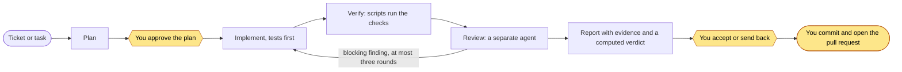

# Orchard Automata

A skill set for iOS development with coding agents. An agent builds a change from a plan you approved, and hands back a report you can check in minutes.

It is plain Markdown and a few Python scripts. It names no agent tool and no model, so it works with any tool that can read a file and run a command.

## The problem it solves

Agents write code faster than a person can read it. Review then turns into approval: the agent says the work is done, the tests pass, and nobody has checked whether those tests prove the right thing.

Orchard treats everything an agent says as a claim. A claim counts only when evidence produced on the final change supports it: a test record, a network log, a screenshot, a recording, a line in the diff. You decide twice, when you approve the plan and when you accept the result. In between, the agents do not wait for you.

## How a change moves



Yellow steps are yours. The rest runs without asking.

## What makes the result checkable

- **Scenarios are the contract.** Behaviour is written as Gherkin scenarios, each with a basis in a spec or a design. Code is never a requirement. The scenario files are the one source of truth between product and engineering, and they are locked during a run.
- **Tests first, and held.** Each test is seen failing before its code exists. From that moment its file is held by hash: an agent cannot quietly loosen it afterwards.
- **Checks are run by scripts.** Every result is recorded with the exact state of the change it ran on. A result from an earlier version is marked stale.
- **The author never reviews.** The reviewer is a separate, read-only agent that never sees the author's reasoning. It also checks the scenarios against the spec, the design and the ticket.
- **The verdict is computed.** A script reads the evidence and the review and answers "Ready to accept", "Not ready" or "Blocked". No agent writes its own verdict.
- **What did not run is named.** A missing screenshot or an unverified claim appears in the report as a gap with its reason.
- **Nothing is published for you.** No skill commits, pushes, or opens, approves or merges a pull request.

The rules behind these are in [principles](docs/principles.md), and the full flow is in the [workflow model](docs/workflow-model.md).

## The twelve skills

Each skill works alone for a daily task. A workflow chains them.

| You want to | Skill |
| --- | --- |
| Start using it in a project | `adopt` |
| Know what to build, and how it will be proved | `plan` |
| Build an approved plan, end to end | `run` |
| Build one package, test first | `implement` |
| Write or repair tests; fix a flaky test; audit a suite | `test` |
| Record what ran on the final change | `verify` |
| Find why something fails, and leave one failing test | `debug` |
| Get an independent review of a change or a pull request | `review` |
| Know where the code is weakest | `debt` |
| Get a report you can accept from | `handoff` |
| Record what shipped in the scenario files | `update-docs` |
| Improve your own use of the skill set from its run log | `retro` |

Three workflows ship with it: `feature-development`, `bug-fix` and `review-only`. A project copies one and edits it.

## Quick start

You need Python 3 (standard library only), git, and Xcode for the project you work on.

**With Claude Code**

```bash
git clone https://github.com/hoangthuytruc/orchard-automata.git
```

```bash
bash orchard-automata/adapters/claude-code/install.sh /path/to/your/ios/project
```

The script copies the skill set into the project's `.claude/skills/orchard` folder and keeps it out of git. Then, in a session inside your project:

1. `/orchard:adopt` drafts the project profile from what it finds in the repository. You confirm each value.
2. `/orchard:plan <ticket or task>` writes one plan file and asks all its questions together, once. You approve it.
3. `/orchard:run` builds the plan and ends with a test report. You accept it or send it back.
4. `/orchard:update-docs` writes the accepted scenario changes into your feature files. You review the diff and commit.

To try one skill without a plan, `/orchard:review` on a branch or a pull request is the quickest.

**With another agent tool**

Point the tool at [AGENTS.md](AGENTS.md). It says where everything lives and how to call a skill. The [Codex](adapters/codex/README.md) and [Cursor](adapters/cursor/README.md) notes exist but have not been tested.

## What it adds to your project

One folder, `.orchard/`, which your team may track or keep local:

| File | Holds |
| --- | --- |
| `profile.md` | The project's facts: build and test commands, where the scenario files, specs and designs live, which files are locked. Each value carries its source |
| `review-rules.md` | The project's own review rules. They win over the generic ones |
| `agents.md` | Which agent and which model class plays each role. A personal override stays out of git |
| `workflows/` | The project's copies of the workflow files |

Your project also needs Gherkin `.feature` files. A project with none names a folder, and its first plan drafts the first scenarios.

## What it does not do

- **It does not replace your judgement.** It makes checking cheaper; you still decide.
- **It does not release.** A workflow ends at "Ready", a handoff to you. TestFlight and the App Store are out of scope.
- **It does not replace your tooling.** Skills call the build, test and lint commands your project already has.
- **It is for iOS and Swift.** The workflow model in `docs/` is platform-neutral, but the references, the checks and the sample are not.

## Status

Version 1, in daily development. What has been shown so far, and what has not:

- **Scripts:** a self-test runs every script against a copy of the sample project: 137 checks, all passing.
- **Sample:** every skill has an eval case that runs on the sample (17 cases). An earlier version passed 12 of 16 in one smoke run. The suite has not been run again since the latest changes.
- **Real projects:** the skill set is installed in one real project, but no feature has yet gone through a full run there.
- **Tools:** only the Claude Code adapter has been used.
- **Cost:** tokens and time per run are recorded when the tool reports them. There are too few runs to state typical figures.

Each change to the skill set is applied to the sample first, and the result is written down in [evals/experiments](evals/experiments/).

## Repository map

```text
docs/          The model: principles, boundaries, scope levels, workflow model, terms
skills/        The twelve skills (one SKILL.md each)
references/    Generic iOS rules the skills cite: standards, review checklist, test strategy
scripts/       Checks and records: profile, locks, scenarios, evidence, plan seal, verdict, run log
roles/         Briefs for the roles a workflow starts
workflows/     feature-development, bug-fix, review-only
templates/     Profile, review rules, agents map, plan, test report, workflow
adapters/      How each agent tool installs the set and starts a role
evals/         One case per skill, run on the sample, and the experiment records
sample/Ledger  A small Swift package and app with seeded defects, used to prove every skill
```

The design and its reasoning are in [docs/skill-set-plan.md](docs/skill-set-plan.md). Words such as scenario, basis, evidence and tier are defined in [docs/terms.md](docs/terms.md).

## Working on the skill set itself

```bash
python3 -I scripts/selftest.py
```

```bash
python3 -I scripts/leak_check.py
```

The leak check fails when the generic parts hold something that belongs to one project or one person: an absolute path, a model name, an email address. Your own private project names and ticket keys go in `.leak-patterns.local`, one `<name>: <regular expression>` per line; git never tracks that file. Guidance for contributors and agents is in [CLAUDE.md](CLAUDE.md).

## Credits and licence

MIT, see [LICENSE](LICENSE). Parts of the review checklist and the test strategy are adapted from two MIT-licensed skills, credited in [THIRD_PARTY_NOTICES.md](THIRD_PARTY_NOTICES.md).
