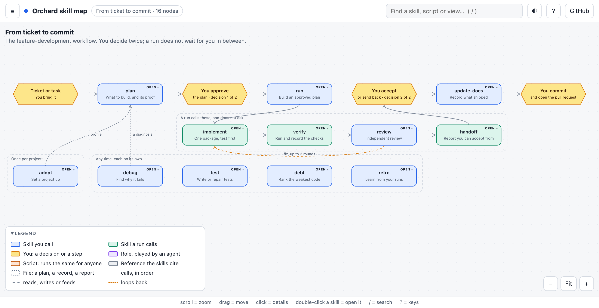

<div align="center">

<h1>🍎 Orchard Automata</h1>

<h3>Approve a plan. Get back an iOS change you can check in minutes.</h3>

<p>Coding agents write faster than you can read.<br>
Orchard makes them <strong>prove</strong> their work, so you check evidence, not promises.</p>

<p>


</p>

<p><a href="#-install">Install</a> · <a href="#-quick-start">Quick start</a> · <a href="#-how-it-works">How it works</a> · <a href="https://hoangthuytruc.github.io/orchard-automata/skill-map/"><strong>Skill map</strong></a></p>

</div>

<p align="center">
<a href="https://hoangthuytruc.github.io/orchard-automata/skill-map/">
<picture>
<source media="(prefers-color-scheme: dark)" srcset="site/skill-map/preview/overview-dark.png">

</picture>
</a>
</p>

<p align="center"><sub>The skill map. <a href="https://hoangthuytruc.github.io/orchard-automata/skill-map/"><strong>Click it for the live version</strong></a>: zoom, search, and open any skill, script or role.<br>Yellow is you. You decide twice; nothing in between waits for you.</sub></p>

## 📦 Install

```bash
git clone https://github.com/hoangthuytruc/orchard-automata.git
```

```bash
bash orchard-automata/adapters/claude-code/install.sh /path/to/your/ios/project
```

That is all. The skills land in your project and stay out of git.

> [!NOTE]
> Needs Python 3, git, and Xcode for your project. Using another agent tool? Point it at [AGENTS.md](AGENTS.md).

## 🚀 Quick start

In a Claude Code session inside your project:

| | You type | What happens |
| :-: | --- | --- |
| **1** | `/orchard:adopt` | It reads your repository and drafts the project profile. You confirm it. |
| **2** | `/orchard:plan <ticket>` | One plan, every question asked once. You approve it. |
| **3** | `/orchard:run` | It builds the plan and hands you a test report. You accept it, then commit. |

> [!TIP]
> Want a taste first? `/orchard:review` on a branch or a pull request works before you write any plan.

## 🔬 How it works

<table>
<tr>
<td width="33%" valign="top">

**Scenarios are the contract**

Behaviour is written as Gherkin scenarios, each backed by a spec or a design. Code is never the requirement.

</td>
<td width="33%" valign="top">

**Tests come first, and stay put**

A test is seen failing before its code exists. After that it cannot be quietly loosened.

</td>
<td width="33%" valign="top">

**Scripts run the checks**

Each result is tied to the exact version of the change it ran on. Old results are marked stale.

</td>
</tr>
<tr>
<td valign="top">

**The author never reviews**

A separate, read-only agent reviews, and checks the work against the spec and the design.

</td>
<td valign="top">

**The verdict is computed**

A script reads the evidence and answers Ready, Not ready or Blocked. No agent grades itself.

</td>
<td valign="top">

**You publish**

No skill commits, pushes or opens a pull request. That stays with you.

</td>
</tr>
<tr>
<td valign="top">

**The plan is checked before you read it**

A separate agent tries to prove the draft plan wrong against the code. Your approval is then bound to that exact text.

</td>
<td valign="top">

**Proof you can look at**

Where the app can run, each scenario gets a screenshot or a recording. What could not be captured is named, not hidden.

</td>
<td valign="top">

**It uses your tools**

Skills call the build, test and lint commands your project already has. The project's facts live in one profile file.

</td>
</tr>
</table>

<div align="center">

<sub>MIT, see <a href="LICENSE">LICENSE</a> · Credits in <a href="THIRD_PARTY_NOTICES.md">THIRD_PARTY_NOTICES.md</a> · All twelve skills: <a href="AGENTS.md">AGENTS.md</a> · Working on the skill set? Read <a href="CLAUDE.md">CLAUDE.md</a></sub>

</div>
