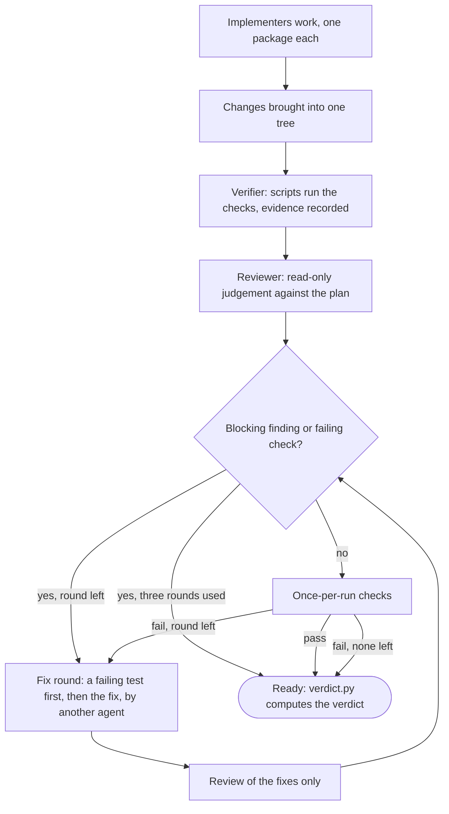

# Workflow model

A workflow is a directed graph. Nodes are **states**; edges are **transitions** guarded by observable conditions. This file is platform-neutral: nothing here names a tool, a model or one project. Words are used as defined in [terms](terms.md); the rules behind them are in [principles](principles.md), [boundaries](boundaries.md) and [scopes](scopes.md).

## Required fields

| Field | Meaning |
| --- | --- |
| Trigger | Event that starts the workflow |
| Inputs | Task context and required project details. Platform details (scheme, workspace, destination) are named here as profile keys, never in the model |
| Roles | Which role owns each state, and on which tier |
| Isolation | The default isolation level, and when a plan may raise it |
| States | Work stages, each with the state contract below |
| Transitions | Conditions that move work between states |
| Evidence | Files, command results, or reviews supporting each transition |
| Decision points | Where a person decides, and what they are shown |
| Handoffs | Actions that belong to a person after `Ready` |
| Recovery | Route after failure, missing input, or interruption |

## State contract

For each state, specify:

1. **Entry:** what must already be true.
2. **Role:** who does the work, and on which tier.
3. **Action:** what is done.
4. **Exit:** what result must be observed.
5. **Evidence:** where that result is recorded.

A transition never depends only on an agent's assertion. For example, `Verify → Review` requires a recorded result of the affected checks on the final change, or an explicit record of what could not run. Transitions are written as `` `From → To` when <observable condition>. ``

## Common states

`Intake → Plan → Implement → Verify → Review → Ready`

Failure paths return to the state that can resolve the issue. Missing requirements return to `Intake`; failing tests return to `Implement`; a review finding returns to `Plan` or `Implement` depending on scope.

`Ready` means work is prepared for its next handoff. It does not itself publish, merge, submit or release anything.

```mermaid
flowchart LR
    T([Trigger]) --> Intake
    Intake -->|a basis for every scenario| Plan
    Plan --> P1{{Person approves the plan}}
    P1 -->|changes asked| Plan
    P1 -->|approved| Implement
    Implement -->|changes in one tree| Verify
    Verify -->|affected checks recorded on the final change, or what could not run named| Review
    Verify -.->|a check fails, round left| Implement
    Review -.->|finding in the code, round left| Implement
    Review -.->|finding in the plan's scope| Plan
    Review -->|no blocking finding, or rounds used up| Ready
    Plan -.->|missing requirement| Intake
    Implement -.->|guessing needed: conflict, lock, wrong plan, missing key| E([Ends early: report with both sides])
    Ready --> P2{{Person accepts or sends back}}
    P2 -->|accepted| U[update-docs: knowledge base diff]
    U --> H{{Person: commit, pull request, merge, release}}

    classDef person fill:#fde68a,stroke:#b45309,color:#000
    class P1,P2,H person
```

Yellow nodes belong to a person; the run does every other step without asking. Dashed edges are failure paths. A run can end early from any state; the diagram shows it once.

## Decision points

A run needs a person twice: to approve the plan before it starts, and to accept the result after it ends. In between it runs without asking.

| When | Person decides | What makes it cheap |
| --- | --- | --- |
| Once per project | The profile is right | Discovery output, already filled in, each value with its source |
| Before a run | The plan: scope, scenarios, split, base branch | One plan file; every open question asked together, once |
| During a run | Nothing | The run does not wait |
| After a run | Accept, or send back | One report: each scenario with its test and proof, what did not run, the remaining findings |
| After acceptance | Knowledge base diff; commit, pull request, merge, release | The diff with its check result; a draft pull-request body |

A run **ends early** only when going on would mean guessing: sources conflict with no rule to settle them, a locked file would have to change, the plan is wrong, or a required profile key is missing. It then reports both sides and ends; it does not wait mid-run for an answer. Review rounds that run out do not stop it: the remaining findings go into the report. A required check that still fails when the rounds are used up makes the verdict `blocked`.

## Roles

| Role | Does | A separate agent? |
| --- | --- | --- |
| Coordinator | Drives the workflow: starts each role, checks each transition's evidence. Does none of the work | No: the session the developer started |
| Planner | Writes the plan with the developer | No: the session the developer talks to |
| Implementer | Writes tests, then code, for one work package | Yes, at Standard and Strict |
| Verifier | Runs the project's checks and records results | No: scripts produce the evidence |
| Reviewer | Judges the change against the plan, read-only | Yes, always |
| Documenter | Writes the report, and after acceptance the knowledge base | Only at Strict, for the report. At every level the report quotes the verdict `scripts/verdict.py` computes; no writer decides it |

Agents do not talk to each other. They work through files: the plan, the brief, the diff, the evidence, the report. A role is bound to a real agent by the agents map ([scopes](scopes.md#the-agents-map)).

## Tiers

Each state names a tier, never a model: **strong** or **light**. The plan gives each package a tier and a one-line reason: strong when the cause or the design is still uncertain, or when a mistake would reach a shared contract, stored data, sign-in, payments or concurrency; light otherwise. A fix takes its tier from its finding the same way. Where the plan says nothing, implementation, fixes and the review of fixes run light; the full review runs strong. A package that fails two loops on its tier runs its third on strong, with both failures in its brief; after that the run stops.

## Isolation levels

| | Shared | Standard (default) | Strict |
| --- | --- | --- | --- |
| Separate agents | Reviewer | Implementers, reviewer | Implementers, reviewer, report writer |
| Agents started, P packages, clean run | 1 | P + 1 | P + 2 |
| Fits | A change in one or two files with a clear cause | An ordinary feature or defect, one to four packages | Risk (sign-in, payments, stored data, concurrency, shared component) or a long run. The verdict does not depend on the level: a script computes it from the evidence and the review |
| Tokens and time | Not measured | Not measured | Not measured |

No level is known to be cheaper or faster. The one measurement so far, on one bug, ran against the expectation: the separate implementer at Standard used fewer tokens than the main session at Shared ([experiment](../evals/experiments/2026-11-26-planning-and-isolation.md)). One bug sets no default.

The workflow file names the default; the plan may raise it, or lower it to Shared for a change in one or two files with a clear cause, for one change or one package, with a one-line reason. It is never lowered below a separate reviewer. Checks are run by scripts at every level. Being unattended is never a reason to raise the level. When the main session builds a single package itself, the run is logged as Shared.

## Rules of a run

1. **The plan is the contract.** Every agent works from the approved plan file, not from what another agent said.
2. **The brief is the agent's whole world.** It carries everything the agent needs and nothing else.
3. **One writer per file.** The plan gives each file to one package.
4. **A shared tree or a working copy each.** A conflict between working copies ends the run: the split was wrong.
5. **Walls that keep judgement independent.** The reviewer never sees the author's reasoning, never edits, never fixes. The agent that fixes a finding is not the one that raised it.
6. **Stop and say, never reach.** An agent that needs a file it does not own stops and names the file.
7. **Tiers by uncertainty and consequence**, as above.
8. **One shared device, one run.** Two test runs on the same simulator or device stall each other.

One round, in order: implementers work; their changes are brought into one tree; the verifier runs the checks; the reviewer judges; the coordinator starts a fix round or moves to `Ready`. At most three rounds. Each fix starts with a test that fails because of the finding, and is followed by a review of the fixes only. Checks that run once per run run after the last round; if one fails and a round is left, that opens a fix round; if none is left, the run goes to `Ready` with verdict `blocked`.

## Run log

Every run appends one record to the run log on the developer's machine, written by `scripts/runlog.py`, never recalled by an agent. Fields: workflow, isolation level, tier per package and for diagnosis and planning; where the run ended early and why; findings with category and cited rule; checks that failed first try; flaky tests; tokens and time per role and round, or "not available", never estimated; steps up to strong and the failure before each; waits on the device or backend; time from request to handoff, with the wait for approval separate; what was sent back at acceptance, in the developer's words. `retro` reads it.
